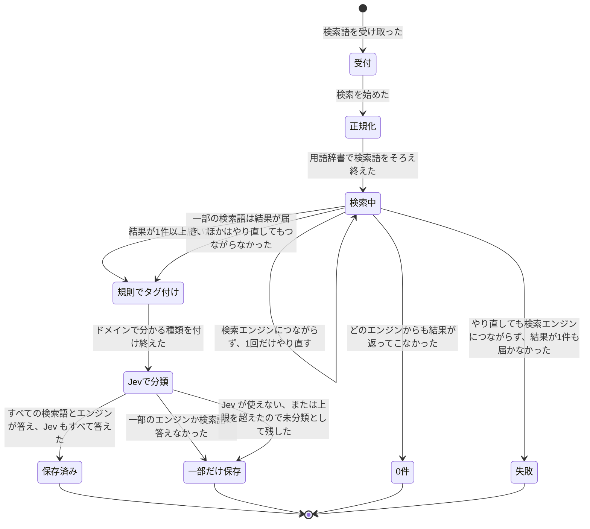

# jevsearch 仕様書

> design-flow v2 の step 3（to-spec）と step 4（状態の図）の成果物です。用語は [GLOSSARY.md](../../GLOSSARY.md) に合わせています。atelier（PBI に分けた実装と検証）にそのまま渡せる粒度で書いています。
> 「推定」と付いた箇所は、合意済みの決定から書き手が補った値・形で、実装前に確かめるか、atelier の plan 段で確定させてください。

## Problem Statement

ユーザーは AI レーダーや日々の調べ物で、論文・技術ブログ・ニュース・SNS などをまたいで情報を集めたい。しかし今は次の問題がある。

- 検索サイトごとに表記ゆれや日英の違いで取りこぼしが出る。同じ技術でも「サーバ」「サーバー」「server」で結果が変わる。
- 自分で動かせるメタ検索エンジン（RustXNG）はあるが、結果に「論文なのか、ブログなのか、SNS なのか」という種類の情報がなく、あとから種類別にまとめられない。
- Google などの検索結果ページを読み取る方式は、規約の面で不安があり、普段使いにしたくない。
- 結果を残す場所と粒度がばらばらで、レーダーのルーティンがトピックごとにまとめる入口がない。
- 分類に LLM を使う場合、1件ずつ問い合わせると費用と時間がかさみ、どこまで規則で決められて、どこから LLM が効いているのかも測れない。

## Solution

`jevsearch` という独立した Python の CLI を作る。ユーザーが検索語（と任意のトピック）を渡すと、1つの検索ジョブとして次を行う。

1. 用語辞書で検索語をそろえる（辞書にない語はそのまま使う）。
2. 検索の接続口を通して、127.0.0.1 で動く RustXNG に HTTP で問い合わせる。既定では公式 API エンジンだけを、エンジン名で指定して使う。画面読み取りエンジンは、明示的に許可したときだけ足す。
3. ドメイン規則で決められる種類は規則で決める。
4. 残りの判定（規則で決まらなかった種類、ジャンル、関連性、検索語のジャンル）は、結果を 20〜30 件ずつまとめて Jev に1回で問い合わせ、1件ずつの判定と確信度を受け取る。確信度がしきい値（既定 0.55）未満の判定は未分類にする。
5. すべての結果を、検索語と取得日時とともに結果ログ（JSONL）に残す。共有メモリには、トピックと日付ごとに1件のダイジェストを書く。
6. 結果が0件でも失敗にせず「0件」として記録する。一部のエンジン、一部の検索語（日本語版・英語版のどちらか）、または Jev が失敗しても、取れた結果は残す（一部だけ保存）。Jev が失敗した結果は未分類として残す。失敗になるのは、どの検索語でも結果が取れず、やり直してもつながらない検索語が残ったときだけ。
7. 規則と Jev の分担、まとめて判定と1件ずつ判定の一致率、日本語での精度、Jev の使用量、エンジンの失敗を評価記録に残し、仕組みの効き目を後から比べられるようにする。

RustXNG は外付けで、つなぐのは HTTP だけにする。接続先の URL と版は設定に置くので、あとでフォークした版に差し替えても jevsearch の中身は変わらない。リポジトリは公開（`reeschan/jevsearch`）なので、API キーは環境変数からだけ読み、リポジトリには一切入れない。

## User Stories

### 検索する

1. As a ユーザー, I want 検索語を1つ渡すだけで検索ジョブを始められる, so that 毎回エンジンや設定を考えずに済む
2. As a ユーザー, I want 任意でトピックを付けて検索できる, so that 結果がそのトピックのダイジェストにまとまる
3. As a ユーザー, I want ジャンル（論文・技術・ニュース・SNS・ブログ・一般）を指定して検索できる, so that 関係のあるエンジンだけに問い合わせられる
4. As a ユーザー, I want ジャンルを指定しなかったときも妥当なエンジンの組み合わせで検索される, so that 何も考えずに使える
5. As a ユーザー, I want 1回の検索で取る件数の上限を指定できる, so that 費用と時間を抑えられる
6. As a ユーザー, I want 実際には何も呼ばずに、RustXNG に送る内容と Jev に送る質問だけを確かめられる, so that 設定を変えたときに安全に試せる
7. As a ユーザー, I want 結果の件数、未分類の件数、失敗したエンジン、結末（保存済み・一部だけ保存・0件・失敗）を最後に短く表示してほしい, so that 何が起きたかをすぐ把握できる
8. As a レーダーのルーティン, I want CLI を非対話で呼べて、終了コードで結末が分かる, so that 定期実行に組み込める

### 正規化

9. As a ユーザー, I want 「サーバ」「サーバー」のような表記ゆれが用語辞書でそろう, so that 取りこぼしが減る
10. As a ユーザー, I want 用語辞書に英語表記があれば英語でも検索される, so that 英語の資料も拾える
11. As a ユーザー, I want 辞書にない語はそのまま検索に使われる, so that 辞書の整備が追いつかなくても検索できる
12. As a ユーザー, I want 正規化の前と後の検索語が両方記録される, so that 辞書が効いたかを後で確かめられる
13. As a 保守する人, I want 用語辞書を人が読める形式で編集でき、版が記録に残る, so that 辞書を変えた前後で結果を比べられる

### エンジンと規約

14. As a ユーザー, I want 既定では公式 API エンジンだけが使われる, so that 規約上の不安がない
15. As a ユーザー, I want 画面読み取りエンジンは明示的なオプションを付けたときだけ使われる, so that うっかり規約の気になる取得をしない
16. As a ユーザー, I want ジャンルごとに使うエンジンの一覧を設定で変えられる, so that 合わないエンジンを外せる
17. As a ユーザー, I want エンジンをカテゴリではなく名前で指定して問い合わせる, so that RustXNG の設定の不具合でエンジンの選ばれ方がずれない
18. As a ユーザー, I want 一部のエンジンや一部の検索語（日本語版・英語版）が失敗しても、ほかで取れた結果は残る, so that 1つの不調で検索全体が無駄にならない
19. As a ユーザー, I want どのエンジンがなぜ失敗したかが記録される, so that 休みが続くエンジンを一覧から外す判断ができる

### 検索の接続口

20. As a 保守する人, I want RustXNG の URL と版を設定で変えられる, so that あとでフォークした版に差し替えられる
21. As a 保守する人, I want 検索の接続口が返す結果の形が URL・タイトル・抜粋・エンジン・公開日の5つに固定されている, so that 接続先の項目が増えても壊れない
22. As a ユーザー, I want RustXNG につながらず結果が1件も取れなかったときは、はっきり「失敗」と表示される, so that RustXNG を起動し忘れたことにすぐ気づける
23. As a 保守する人, I want 接続先の RustXNG の版が記録に残る, so that 版を変えた前後で結果を比べられる

### 種類・ジャンル・関連性の判定

24. As a ユーザー, I want arxiv.org や github.com のように、ドメインで分かる種類は規則で決まる, so that 費用をかけずに確実に分類される
25. As a ユーザー, I want 規則で決まらない種類は Jev に判定される, so that ブログか、ニュースかといった区別も付く
26. As a ユーザー, I want 各結果にジャンルが付く, so that 分野別に読める
27. As a ユーザー, I want 各結果に「検索語に合っているか」が付く, so that 関係のない結果をまとめから外せる
28. As a ユーザー, I want 検索語そのもののジャンルも判定される, so that ジャンルを指定しなかった検索の傾向を後で見られる
29. As a ユーザー, I want 確信度がしきい値未満の判定は未分類として残る, so that 怪しい分類がまとめに混ざらない
30. As a ユーザー, I want しきい値を設定で変えられる, so that 評価の結果に合わせて調整できる
31. As a ユーザー, I want 各判定に「規則で決まったか、Jev で決まったか」と確信度が残る, so that 後で精度を確かめられる
32. As a ユーザー, I want 検索結果をまとめて Jev に送り、1件ずつの判定を受け取る, so that 1件ずつ送るより安く速く済む
33. As a ユーザー, I want 1回に送る件数が多すぎるときは自動で分けて送られる, so that 上限に引っかからない
34. As a ユーザー, I want Jev が混み合っているときは自動でやり直してくれる, so that 一時的な不調で未分類が増えない
35. As a ユーザー, I want Jev が使えないときや上限を超えたときも、結果は未分類として保存される, so that 検索結果そのものは失われない
36. As a ユーザー, I want Jev に送るのは検索語・タイトル・URL・抜粋と、内部の ID・ドメイン名・エンジン名だけ, so that 余計な情報が外部に出ない

### 保存とダイジェスト

37. As a ユーザー, I want すべての結果が、検索語と取得日時とともに結果ログに1件ずつ残る, so that 後から何でも集計し直せる
38. As a ユーザー, I want 0件の検索も「0件」として記録される, so that 「探したがなかった」ことも分かる
39. As a レーダーのルーティン, I want トピックと日付ごとに1件のダイジェストが共有メモリにある, so that タグごとにまとめを書ける
40. As a レーダーのルーティン, I want 同じ日に同じトピックで何度検索しても、ダイジェストは1件のまま更新される, so that まとめが重複しない
41. As a ユーザー, I want ダイジェストが今のレーダーと同じタグの付け方（`news:radar-bot:<topic>`）になっている, so that 既存のルーティンがそのまま読める
42. As a ユーザー, I want 共有メモリに書けなかったときも結果ログは残り、あとで書き直せる, so that 一時的な不調でデータを失わない
43. As a ユーザー, I want トピックのない検索は結果ログだけに残る, so that 共有メモリが散らからない

### 評価と記録

44. As a ユーザー, I want 同じ結果を「まとめて判定」と「1件ずつ判定」で流して一致率を測れる, so that まとめて送っても精度が落ちないことを確かめられる
45. As a ユーザー, I want 日本語の結果での精度を、英語の結果と分けて測れる, so that 日本語で使ってよいかを判断できる
46. As a ユーザー, I want 人が付けた正解と比べるための抜き出しができる, so that 精度を測れる
47. As a ユーザー, I want Jev のモデル名、トークン数、費用の目安が検索ジョブごとに記録される, so that 使用量を把握できる
48. As a ユーザー, I want 規則で決まった割合と Jev で決まった割合が記録される, so that 規則を足す効果を測れる
49. As a ユーザー, I want 設定・用語辞書・ドメイン規則の版が記録される, so that 何を変えたら何が変わったかを追える
50. As a ユーザー, I want 記録を集計して一覧で見られる, so that 傾向をすぐ確かめられる

### 鍵と公開リポジトリ

51. As a ユーザー, I want API キーは環境変数（または手元の認証ファイル）からだけ読まれる, so that 公開リポジトリにキーが入らない
52. As a ユーザー, I want API キーが TypeSafe への認証ヘッダー以外のどこにも送られず、ログや記録や画面の表示、Jev に送る内容（`state` と質問）にも一切含まれない, so that 漏れる経路がない
53. As a ユーザー, I want README に「検索語は米国のサービス（Jev）に送られる」と書いてある, so that 使う人が理解した上で使える
54. As a 保守する人, I want キーが入ったファイルをコミットしにくい仕組み（除外設定と検査）がある, so that 事故を防げる

### 実装と運用

55. As a ユーザー, I want この仕様を atelier にそのまま渡して PBI に分けられる, so that いつもの進め方で実装できる
56. As a 保守する人, I want 外部サービスなしで全テストが通る, so that オフラインでも開発できる
57. As a 保守する人, I want あとで MCP の入口を足せる作りになっている, so that Claude Code から直接呼べるようにできる

## Implementation Decisions

### 全体の形

- 独立した公開リポジトリ `reeschan/jevsearch`（作成はこれから）。Python の CLI。出力は JSONL。MCP の入口は後で足す（今回は作らない）。
- 作るモジュールは次の7つ。どれも下の「合意済みの seam」に対応する。
  1. **設定**: 接続先、エンジン一覧、しきい値、件数などを1つの設定ファイルから読む。秘密は持たない。
  2. **正規化**（用語辞書）
  3. **検索の接続口**（RustXNG アダプター）
  4. **ドメイン規則による種類付け**
  5. **Jev によるまとめて分類**（質問を組み立てる部分と、答えを判定に写す部分）
  6. **保存**（結果ログ、共有メモリのダイジェスト、評価記録）
  7. **CLI と検索ジョブの進行**（下の状態の図どおりに段を進める）
- 段どうしは、検索ジョブ1件分のデータ（検索語、正規化済み検索語、結果の一覧、判定、結末と理由）を受け渡すだけにし、互いを直接呼ばない。

### 設定（推定の項目名を含む）

- RustXNG の接続先 URL（既定 `http://127.0.0.1:29483`）と、期待する版（`0.26.0`）。公開済み v0.26.0 の既定ポートは 8888、main は 29483 なので、URL は必ず設定で明示する。
- ジャンルごとのエンジン一覧（既定は下の表）と、画面読み取りエンジンの一覧。
- 画面読み取りを許すか（既定オフ）。CLI のオプションと設定の両方で許したときだけ使う（推定: 二重の許可）。
- Jev のモデル（`jev-1.14.0` に固定）、1回に送る件数（既定 25、20〜30 の範囲）、しきい値（既定 0.55）、1日の呼び出し上限（既定なし、推定）。
- 保存先（結果ログのディレクトリ）、共有メモリに書くか。

### 正規化

- 処理は用語辞書だけ。文字の正規化（NFKC、全角半角、大文字小文字、前後の空白）をした上で、辞書の見出し語・別名に当たる語を、そろえた言い方に置き換える。英語表記がある語は英語の検索語も作る。
- 辞書にない語はそのまま通す。LLM による言い換えや英訳は行わない。
- 正規化済み検索語は、日本語版と（辞書で作れたときだけ）英語版の最大2本。2本あるときは両方で検索し、同じ URL は1件にまとめ、どちらで当たったかを残す（推定）。
- 辞書には版を持たせ、記録に残す。

### 検索の接続口（RustXNG との契約）

- 呼び出し: `GET <接続先>/search`、パラメータは `q`、`format=json`、`engines=<エンジン名をカンマ区切り>`、`language`、`max_results`（RustXNG 側で 1〜200 に丸められる）。任意で `time_range`。
- エンジンは必ず `engines=` で名前を指定する。`categories=` は使わない（settings.toml の xpath エンジン22件でカテゴリが1文字ずつに分かれている不具合のため）。
- 応答のうち使うのは `results[]` の `url`、`title`、`content`、`engine`、`publishedDate` と、`unresponsive_engines`（失敗したエンジンと理由）だけ。接続口はこれを「URL・タイトル・抜粋・エンジン・公開日」の5項目に写して返す。ほかの項目は無視する。
- 結末の判定:
  - 判定は検索語（日本語版と、あれば英語版）ごとの応答をまとめて行う。つながらない、または HTTP エラーになった検索語だけを1回だけやり直す（推定: やり直し1回）。正常に応答した検索語は聞き直さない。
  - やり直してもつながらない検索語が残り、どの検索語でも結果が取れなかった → 検索ジョブは **失敗**。
  - やり直してもつながらない検索語が残ったが、ほかの検索語で結果が1件以上取れた → 取れた結果は使い（捨てない）、最後の結末を **一部だけ保存** にする。つながらなかった検索語は理由として記録する。
  - すべての検索語が正常に応答し、結果が合わせて0件 → **0件**。
  - 結果あり、かつ `unresponsive_engines` が空でない → 結果は使い、最後の結末を **一部だけ保存** にする。
- 接続口は1つのインターフェースで、RustXNG 用の実装を1つだけ作る。あとでフォーク版や別の検索に差し替えるときは、この実装を足すか URL を変えるだけにする。

### 既定のエンジン一覧（RustXNG v0.26.0 の settings.toml で名前と有効を確認済み）

| ジャンル | 既定（公式 API・公式フィード） | 画面読み取り（オプション時のみ） |
|---|---|---|
| 論文 | arxiv, crossref, semantic scholar, openalex（医学系に pubmed, europepmc） | google_scholar |
| 技術 | github, stack overflow, hackernews, mdn, microsoft_learn, gitlab, crates.io, npm | pypi, lib_rs |
| ニュース | google news（RSS）, hackernews, wikinews | bing news |
| SNS | mastodon, lemmy, tootfinder | なし |
| ブログ | wiby | searchmysite, neocities |
| 一般 | wikipedia, mwmbl | google, bing, brave, duckduckgo, mojeek, yahoo japan |

- ジャンル未指定のときは、一般＋技術＋論文の既定エンジンを使う（推定）。
- API キーが要るエンジン（core、braveapi、marginalia、springer）は既定に入れない。

### ドメイン規則による種類付け

- 結果の URL のドメインだけで種類を決める。例: arxiv.org・doi.org・semanticscholar.org・openalex.org → 論文、github.com・gitlab.com → リポジトリ、developer.mozilla.org・learn.microsoft.com・docs.* → ドキュメント、mastodon.*・lemmy.*・x.com → SNS、qiita.com・zenn.dev・note.com・medium.com・*.hatenablog.com・dev.to → ブログ、news.google.com 経由・wikinews.org → ニュース。
- 規則で決まった種類は確信度 1 として扱い、Jev には種類の質問を出さない。
- ジャンルと関連性は規則では決めない（すべて Jev に聞く）。
- 規則の一覧には版を持たせ、記録に残す。

### Jev によるまとめて分類（API の契約）

- 送り先: TypeSafe System One、`POST https://api.typesafe.ai/v1/systemone`、`Authorization: Bearer <キー>`。API キーはこの認証ヘッダーにだけ入れ、`state`・質問・ほかのどの送り先にも入れない。キーは環境変数 `TYPESAFE_API_KEY`、なければ手元の `~/.config/typesafe/credentials.json` から読む。モデルは `jev-1.14.0` に固定。公式 SDK（`typesafe_sdk`）を使ってよい（推定）。
- 1回のリクエストに結果を 20〜30 件（既定 25）まとめる。超える分は複数のリクエストに分ける。1リクエスト 64k トークンを超えそうなら、さらに分ける。
- `state` には、検索語と結果の一覧だけを入れる。各結果は `id`（`r01` のような内部の番号）、`title`、`url`、`domain`（ドメイン名）、`snippet`（抜粋）、`engine`（エンジン名）だけを持つ。Jev に送ってよいのは、検索語と、この6項目を合わせた7項目だけ（`%% never` の決まり）。下は形を示すための例（試作ではない）:

  ```json
  {"query": "rust メタ検索",
   "results": [{"id": "r01", "title": "...", "url": "https://...", "domain": "github.com",
                "snippet": "...", "engine": "github"}]}
  ```

- 質問は英語で書き、どの結果について聞くかを `results[i]`（id 付き）で明示する。1件ごとに次を出す。
  - `type_rNN`（choice）: paper / blog / news / sns / docs / repo / other。ドメイン規則で決まった結果には出さない。
  - `genre_rNN`（choice）: paper / tech / news / sns / blog / general。
  - `relevant_rNN`（noul）: criteria の true は「検索語の意図に合っている」、false は「合っていない」。
  - リクエストごとに1つ `query_genre`（choice、選択肢はジャンルと同じ）。
- 答えは質問ごとに独立して `choice`（または noul の確率）、`probabilities`、`confidence` を持つ。これを結果ごとの判定に写す。
  - choice は `confidence` がしきい値以上なら採用、未満なら **未分類**。
  - noul は、確率 p から確信度を max(p, 1−p) として同じしきい値で判定する（推定）。
  - 答えが欠けた質問は未分類。
- 再試行: 429 と 529 は間隔を空けて最大3回（推定: 回数と間隔）。それでも駄目、接続エラー、1日の上限超過のときは、そのリクエストに入っていた結果の Jev 判定をすべて未分類にし、検索ジョブの結末を **一部だけ保存** にする。
- 記録: リクエストごとにモデル名、入力・出力トークン数、所要時間、件数、質問数を残す。送った `state` と質問は評価用に残してよいが、キーと応答の生データ全体は残さない（推定）。

### 保存

- **結果ログ（JSONL）**: 1結果1行。必須項目は、検索ジョブの id、検索語、正規化済み検索語、取得日時（タイムゾーン付き）、URL、タイトル、抜粋、エンジン、公開日、種類・ジャンル・関連性それぞれの「値（または未分類）・決め方（rule / jev）・確信度」、トピック（あれば）、設定・用語辞書・規則・Jev モデル・RustXNG の版。下は形を示すための例:

  ```json
  {"schema": 1, "job_id": "...", "query": "...", "query_norm": {"ja": "...", "en": "..."},
   "retrieved_at": "2026-11-02T21:05:12+09:00", "topic": "search-engine",
   "url": "...", "title": "...", "snippet": "...", "engine": "github", "published_date": null,
   "type": {"value": "repo", "by": "rule", "confidence": 1.0},
   "genre": {"value": "tech", "by": "jev", "confidence": 0.83},
   "relevant": {"value": null, "by": "jev", "confidence": 0.51},
   "versions": {"config": "...", "dictionary": "...", "rules": "...", "jev_model": "jev-1.14.0", "rustxng": "0.26.0"}}
  ```
  `value: null` が未分類を表す（推定）。
- **検索ジョブの記録**: 検索ジョブ1件につき1行を別に残す。結末（保存済み / 一部だけ保存 / 0件 / 失敗）と理由（失敗したエンジン、つながらなかった検索語、Jev の失敗、上限超過）、件数、未分類の件数、所要時間。0件と失敗もここに必ず残る。
- **ダイジェスト（共有メモリ）**: トピックがある検索ジョブだけ。ユーザーの手元の shared-memory MCP に、トピックと日付ごとに1件、タグ `news:radar-bot:<topic>` で書く。中身は、その日のそのトピックの結果の URL・タイトル・種類・ジャンル・エンジンの一覧（関連性が「合っていない」と判定されたものは除く、推定）。同じ日に再度検索したら同じ1件を更新する。書けなかったときは結果ログは残し、次回か専用のコマンドで書き直す（推定）。
- 共有メモリへの書き込みは、手元の MCP を呼ぶ形のため、CLI からの呼び方（MCP クライアントとして呼ぶか、Claude Code 側から書かせるか）は atelier の plan 段で決める（推定・未決）。

### 評価記録

- 検索ジョブごと: 規則で決まった割合と Jev で決まった割合、未分類の割合、確信度の分布、Jev のトークン数と費用の目安、エンジンごとの失敗と理由。
- 比較用のコマンド: 同じ結果を「まとめて1回」と「1件ずつ1回」で Jev に流し、判定ごとの一致率を出す。日本語の結果（タイトルの文字種で判定、推定）と英語の結果で分けて出す。
- 精度用: 人が正解を付けるための抜き出し（CSV）と、付けた正解との一致率の集計。

### CLI（推定のコマンド名）

- `jevsearch search "<検索語>" [--topic <名前>] [--genre <ジャンル>] [--max <件数>] [--allow-scrape] [--dry-run]`
- `jevsearch eval batch-vs-single <結果ログ>`（一致率）、`jevsearch eval sample --n 50`（人の判定用の抜き出し）
- `jevsearch stats [--since <日付>]`（評価記録の集計）
- `jevsearch digest --retry`（書けなかったダイジェストの書き直し）
- 終了コード: 保存済み 0、一部だけ保存 0（標準エラーに警告）、0件 0、失敗は 0 以外（推定）。

### 状態の図（検索ジョブ1件）



- 確信度が低いだけで未分類になった結果は、検索ジョブの結末を変えない（保存済みのまま、未分類の件数として記録する。推定）。結末が「一部だけ保存」になるのは、エンジンの失敗、一部の検索語がやり直してもつながらなかったとき（ほかの検索語で結果が取れた場合）、Jev そのものが使えなかったときだけ。
- 共有メモリのダイジェストに書けなかったことも結末は変えず、記録に理由として残す（推定）。

## Testing Decisions

### よいテストの条件

- 外から見える振る舞いだけを確かめる（入力に対して、どの結果が、どの判定と結末で保存されるか）。内部の関数の呼び方や順番は確かめない。
- 外部サービス（Jev、RustXNG、共有メモリ）は、単体テストでは必ず差し替え（モック）にする。ネットワークなしで全テストが通ること。
- 状態の図の各遷移と、`%% never` の各行に、少なくとも1つずつテストを対応させる。
- 録っておいた本物の応答（RustXNG の JSON、Jev の応答）を固定のデータとして使い、差し替えの返り値にする。API キーは含めない。

### 合意済みの seam

1. **検索の接続口（RustXNG アダプター）**: HTTP の手前で差し替える。確かめること: `engines=` に名前で指定し `categories=` を使わないこと、画面読み取りエンジンがオプションなしでは入らないこと、応答を5項目に写すこと、`unresponsive_engines` を失敗したエンジンとして返すこと、つながらない検索語だけの1回のやり直し、どの検索語でも結果がないときの失敗、一部の検索語だけ結果が取れたときに結果を残して一部だけ保存になること、0件の扱い。
2. **正規化（用語辞書）**: 辞書を入力にした純粋な変換として確かめる。表記ゆれ、英語版の生成、辞書にない語がそのまま通ること。
3. **ドメイン規則による種類付け**: URL を入力にした純粋な判定として確かめる。決まった種類、決まらない結果、規則で決まったものに Jev の種類の質問が出ないこと。
4. **Jev によるまとめて分類**: 質問を組み立てる部分と、答えを判定に写す部分を分けて確かめ、Jev 本体は差し替える。確かめること: `state` に検索語・タイトル・URL・抜粋・内部の ID・ドメイン名・エンジン名の7項目以外が入らないこと（キーが `state`・質問に入らず、認証ヘッダーにだけ入ること）、1件ごとの質問 id と `results[i]` の対応、25件を超えると分かれること、64k トークンを超えそうなら分かれること、しきい値未満が未分類になること、429/529 のやり直し、失敗時に全件が未分類になること、モデル名と使用量が記録されること。
5. **保存（結果ログ、共有メモリのダイジェスト）**: 一時ディレクトリと差し替えた共有メモリで確かめる。全行に検索語と取得日時があること、0件と失敗が検索ジョブの記録に残ること、同じ日・同じトピックのダイジェストが1件のまま更新されること、共有メモリが失敗しても結果ログが残ること。
6. **CLI**: いちばん高い seam。接続口・Jev・共有メモリを差し替えた状態で CLI を通しで動かし、状態の図の4つの結末（保存済み・一部だけ保存・0件・失敗）がそれぞれ正しい記録と終了コードになることを確かめる。`--dry-run` で外部が一度も呼ばれないことも確かめる。

### 単体テスト以外

- RustXNG を 127.0.0.1 で実際に動かした結合テストは、明示的に指定したときだけ動く別枠にする（既定では動かさない）。
- Jev を実際に呼ぶのは評価（まとめて判定と1件ずつ判定の比較、日本語の精度）のときだけで、テストには含めない。

### 先例

- 新しいリポジトリのため、リポジトリ内の先例はない。atelier の Jev 呼び出し（429/529 の再試行、失敗しても既定値で進む決まり）の作りと、TypeSafe の公式 cookbook（1回のリクエストに多数の質問を立てる例）を参考にする。

## Out of Scope

- X（旧 Twitter）の検索。今あるレーダーのルーティンに任せる。
- Cookie やログイン情報を渡して、認証が必要なページを取ること。
- RustXNG 本体の改造やフォーク。jevsearch からは HTTP で呼ぶだけ。
- RustXNG を 127.0.0.1 以外で公開すること。
- LLM による検索語の言い換え・英訳（正規化は用語辞書だけ）。
- 検索結果の要約そのもの（レーダーのルーティンが受け持つ）。
- MCP や HTTP の入口（あとで足す）。
- API キーが要るエンジン（core、braveapi、marginalia、springer）の既定利用。
- 取得したページ本文の保存と再配布。

## Further Notes

- **公開リポジトリと鍵**: API キーは環境変数か手元の認証ファイルからだけ読む。リポジトリには例の設定ファイル（キーなし）だけを置き、除外設定とコミット前の検査を入れる。
- **README の注意書き**: 検索語、結果のタイトル・URL・抜粋・ドメイン名・エンジン名（と内部の ID）が、米国のサービス（TypeSafe の Jev）に送られることを明記する。
- **Jev の注意点**（公式ドキュメントより）: `state` に関係のない内容が増えると精度が落ちる。日本語は扱えるが英語と同等ではない。このため `state` は最小限にし、日本語の精度は評価記録で別に測る。
- **RustXNG の版**: 開発が速い（約2週間で v0.26）ため、版を設定で固定し、記録に残す。作者自身の監査で P1 の未解決問題が残っているので、127.0.0.1 だけで動かす。
- **atelier への渡し方**: この PC の Claude Code で atelier を回す。PBI の切り方の目安（推定）は、①設定と CLI の骨組み（`--dry-run` まで）、②検索の接続口、③正規化、④ドメイン規則、⑤Jev によるまとめて分類、⑥保存（結果ログと検索ジョブの記録）、⑦ダイジェスト、⑧評価記録と比較コマンド、⑨README と鍵の検査。①が先、②〜④は並行でき、⑤は④の後、⑥〜⑧は⑤の後。
- **未決（実装中に決める）**: 共有メモリへの書き方（CLI から MCP クライアントとして呼ぶか）、ジャンル未指定のときのエンジンの組み合わせ、1日の Jev 上限の既定値。
